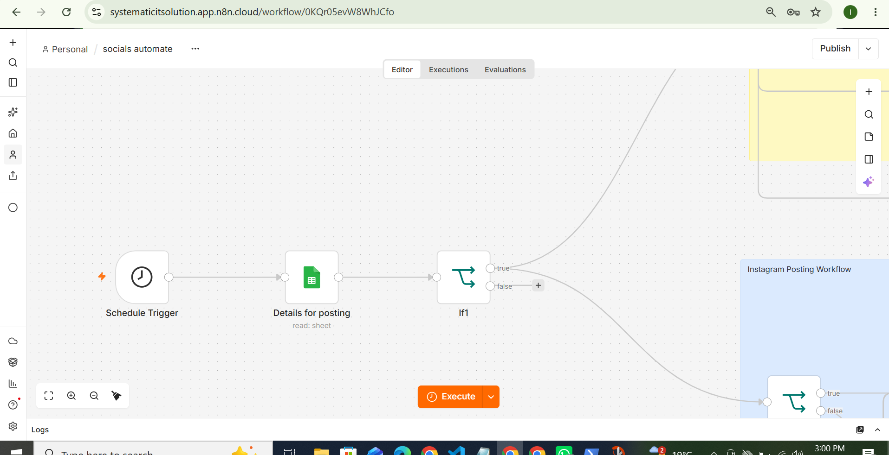
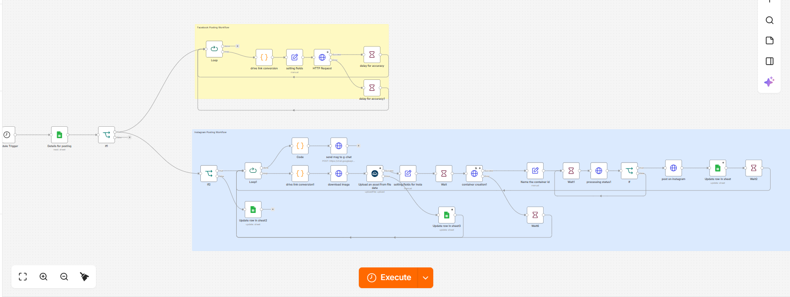

# Social Media Publishing Automation

**Automating Facebook and Instagram publishing with n8n, Google Sheets, Meta Graph API, and Cloudinary.**

Developed and maintained at **Pexdel Solution**, this project automates recurring social media publishing tasks across multiple client accounts.

## Project Overview

Managing social media for multiple clients involves coordinating content, captions, images, publishing schedules, and account-specific settings. This project uses n8n to connect these tasks into a centralized automation workflow.

The workflow retrieves client records from Google Sheets, evaluates posting conditions, and routes eligible records into Facebook and Instagram publishing branches.

## Key Features

- **Scheduled execution:** Starts publishing workflows on a configured schedule.
- **Centralized configuration:** Reads client details, captions, account IDs, and posting conditions from Google Sheets.
- **Conditional routing:** Evaluates posting conditions before processing records.
- **Facebook publishing:** Sends image posts and captions through the Meta Graph API.
- **Instagram publishing:** Downloads images, uploads media to Cloudinary, creates media containers, checks processing status, and publishes posts.
- **Workflow coordination:** Uses loops, conditions, delays, and HTTP requests to coordinate publishing steps.
- **Spreadsheet updates:** Updates Google Sheets at designated points in the workflow.

## Technology Stack

| Technology | Purpose |
|---|---|
| n8n | Workflow orchestration |
| Google Sheets | Client data and publishing configuration |
| Meta Graph API | Social media publishing |
| Cloudinary | Image hosting |
| JavaScript | Data transformation and expressions |
| HTTP Request | API integration |

## Workflow Architecture

```text
Schedule Trigger
       |
       v
Google Sheets: Read Client Data
       |
       v
Posting-Day Condition
       |
       +-------------------+
       |                   |
       v                   v
Facebook Workflow    Instagram Workflow
       |                   |
Prepare Image         Download Image
and Caption                |
       |                   v
       |             Cloudinary Upload
       |                   |
       |                   v
       |             Create Media Container
       |                   |
       |                   v
       |             Check Processing Status
       |                   |
       v                   v
Meta Graph API       Meta Graph API
       |                   |
       v                   v
Facebook Post        Instagram Post
                           |
                           v
                   Google Sheets Update
```

*This is a high-level illustration; see the screenshots below for the actual n8n workflow.*

## Workflow Screenshots

### 1. Workflow Overview

The Schedule Trigger starts the automation, which retrieves client records and routes them according to the configured conditions.



### 2. Facebook Posting Workflow

Shows the Facebook publishing branch, including image-link conversion, field mapping, and the API request.


### 3. Instagram Posting Workflow

Shows the Instagram publishing process, including media preparation, Cloudinary upload, container creation, processing checks, and publishing.


### 4. Combined Facebook and Instagram Workflow

Shows the overall workflow layout and how the publishing branches connect to the main automation.



## Engineering Work

My work at Pexdel Solution includes:

- Developing and maintaining n8n automation workflows.
- Integrating external APIs using HTTP requests.
- Mapping structured data between workflow nodes.
- Managing client-specific publishing configuration through Google Sheets.
- Coordinating asynchronous Instagram media processing.
- Troubleshooting publishing failures and Meta API access configuration.

## Security and Privacy

This repository documents the project using workflow screenshots and technical explanations.

- Production credentials and access tokens are not included.
- Private client information should remain confidential.
- Live publishing requires appropriate Meta permissions and access to the relevant accounts.

## Project Information

- **Organization:** Pexdel Solution
- **Project:** Social Media Publishing Automation
- **Focus:** Workflow automation, API integration, publishing operations, and troubleshooting

This project demonstrates practical experience connecting business data, media processing, and social media APIs through a multi-branch automation workflow.
